# Probably Stolen 模組

《Probably Stolen》的遊戲模組，使用遊戲官方的模組格式（不需要 BepInEx / MelonLoader）。

> [!IMPORTANT]
> - **本模組是第三方製作，與遊戲官方無關，請自行評估後使用。**
> - **本模組使用 AI 設計，不喜勿用。**

## 模組清單

### Frequency Radio（黑洞頻率電台）

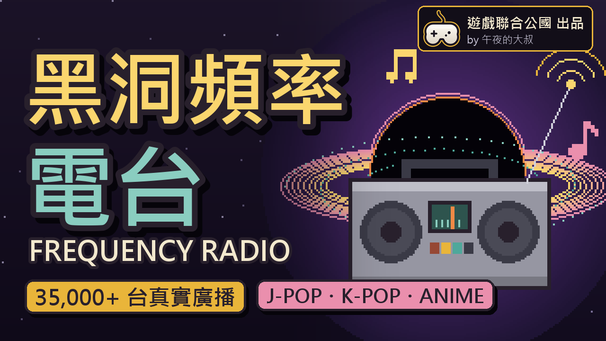

極光造成的時空交錯，讓 2026 年的廣播訊號接進了你的店。

卡帶播放器多一個「電台」分頁：卡帶／電台切換，選國家/地區、選電台，收聽真實的網路廣播。卡帶和電台同時只會播一個。

- 收錄 70 個國家/地區、35,512 台：音樂台、新聞台，以及動漫 / J-pop / K-pop / Vocaloid 網路電台，有類型標示（Pop、JPop、KPop、Anime、News…）。
- 選台：先選國家/地區，台數多的再選州／省（加州、巴伐利亞、浙江…，中文介面顯示中文地名），再選電台；離你最近的國家/地區排在前面。
- 搜尋：輸入台名、類型或國家/地區，所有國家/地區的電台一起找，點一下就播。
- 電台分頁時，控制鈕作用在電台：播放、停止、上一台／下一台；按「隨機」隨機挑一台播。
- 每一台各自記住自己的音量和載入緩衝時間（電台卡頓時可延長載入緩衝）；自動音量平衡（預設開啟）會把小聲和大聲的台調到差不多。勾「統一音量」「統一緩衝」就所有電台用同一個設定，各台原本的設定會保留。
- 按星星把電台加到最愛，在「最愛」分頁直接點選播放。
- 韓文、希臘文、泰文等遊戲字型沒有的台名，用 Windows 內建字型顯示。
- 播放時卡帶播放器會飄出音符。
- 自動平衡、統一音量、統一緩衝、播放飄音可以直接在卡帶播放器上切換，也可以在模組設定調整。
- 搭配聯機模組「[深空串门：可能是联机的 | Probably Multiplayer](https://steamcommunity.com/sharedfiles/filedetails/?id=3828909239)」：拜訪同樣有裝本模組的玩家時，聽得到對方店裡正在放的電台。

**下載**：[Steam 工作坊](https://steamcommunity.com/sharedfiles/filedetails/?id=3830589099)　｜　[更新紀錄](CHANGELOG.md#frequency-radio黑洞頻率電台)

啟用時遊戲會顯示權限警告：網路（收聽電台）、外部反射（搭配聯機模組）。

內容預覽

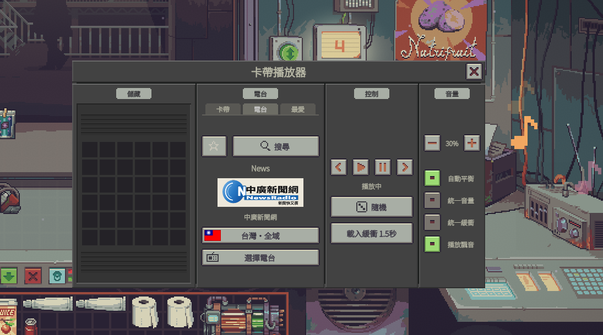
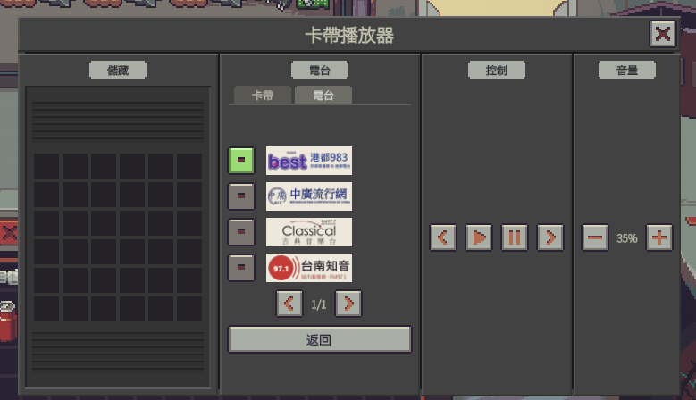
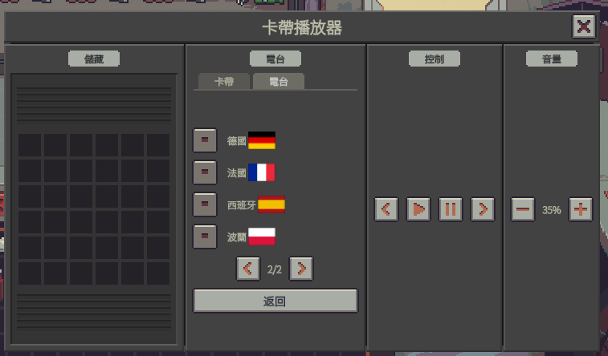
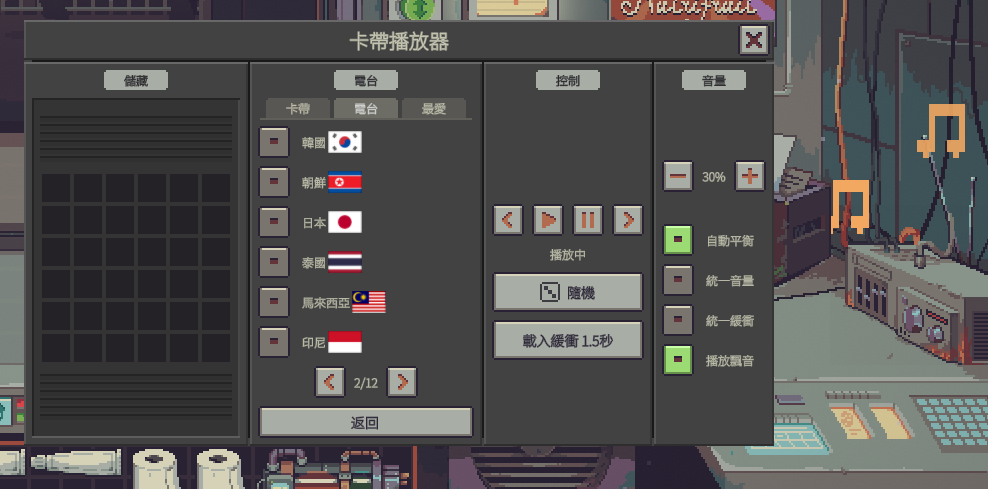
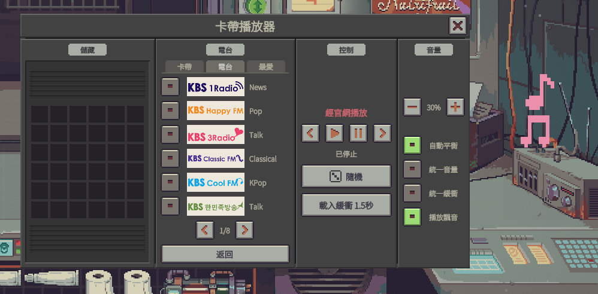
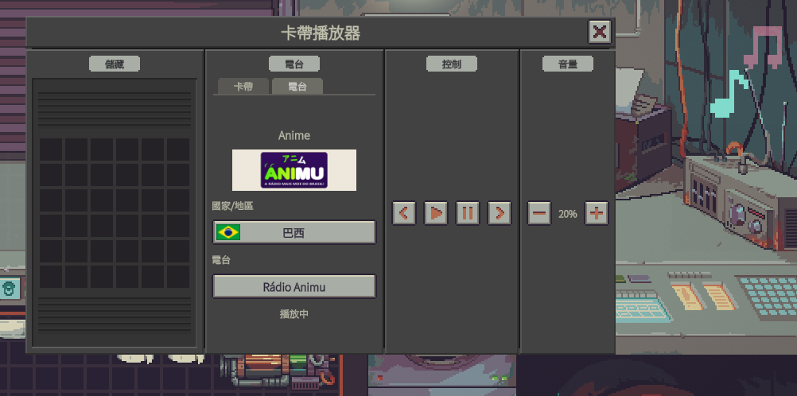
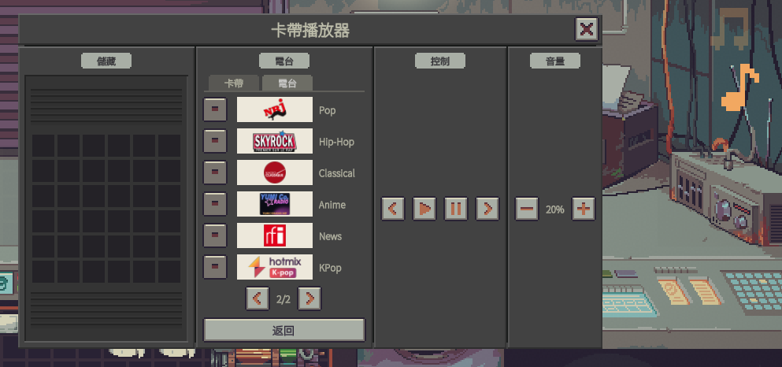
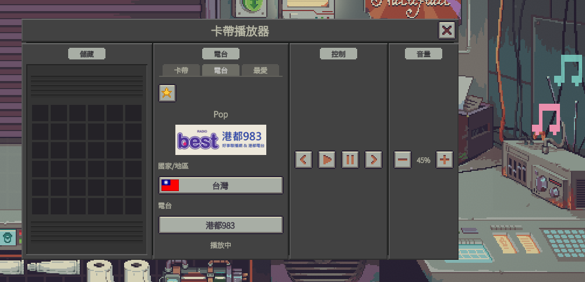
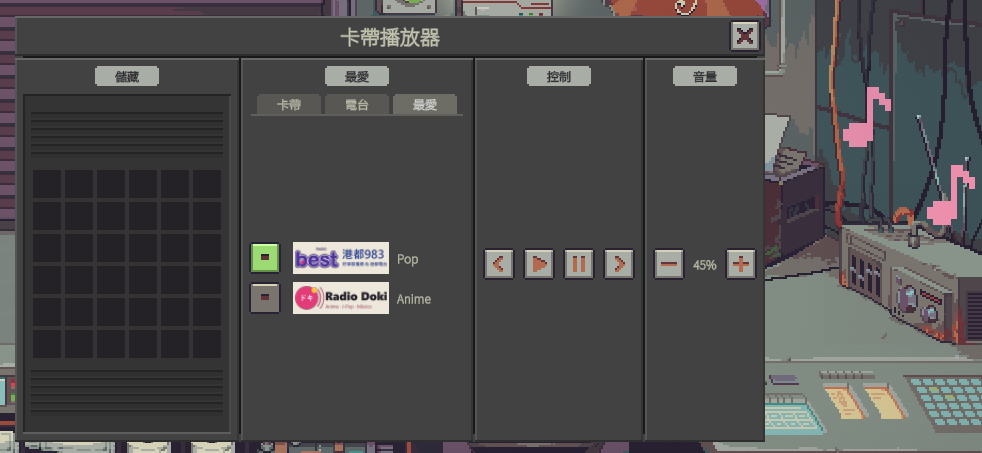
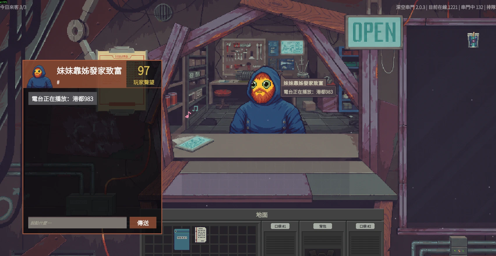

### Frequency TV（黑洞頻率電視）

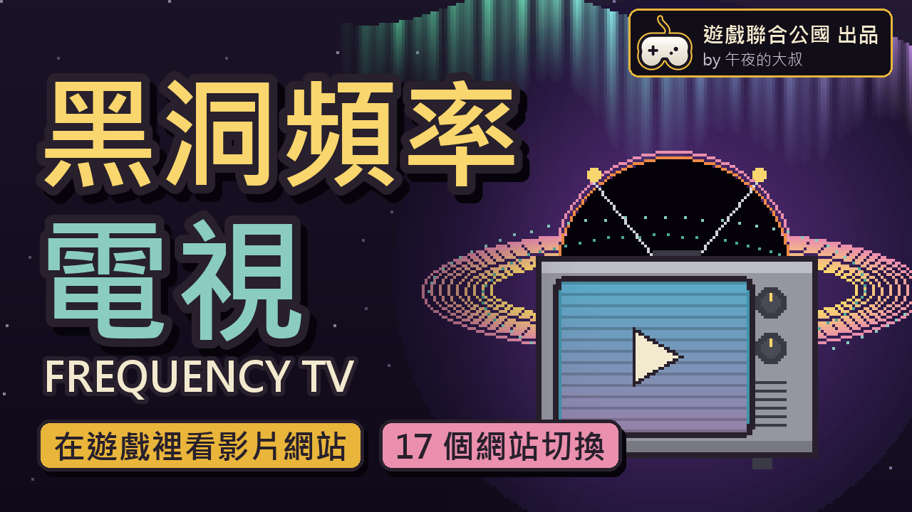

極光造成的時空交錯，讓 2026 年的影像訊號接進了你的店。

- 打開「查看日曆」，日曆／夜間報告／狀態旁邊多一個「YouTube」分頁：在遊戲裡直接看 YouTube，原畫質播放。
- 用滑鼠點選、捲動；滑鼠移到畫面上就能打字搜尋（支援中文輸入法）。
- 分頁旁的小按鈕：上一頁、首頁、暫停。
- 在 YouTube 分頁關掉日曆，影片繼續播，牆上的日曆螢幕變成小電視；點螢幕回到 YouTube 分頁。
- 牆上螢幕的掃描線效果可以開關（分頁旁的「掃描線」或模組設定）。
- 影片音量用 YouTube 播放器的音量調整。

**下載**：[Steam 工作坊](https://steamcommunity.com/sharedfiles/filedetails/?id=3836903387)　｜　[更新紀錄](CHANGELOG.md#frequency-tv黑洞頻率電視)

啟用時遊戲會顯示權限警告：網路（觀看 YouTube）、Steam（使用 Steam 內建的瀏覽器播放）。

## 安裝

在模組的 Steam 工作坊頁面按「訂閱」→ 開遊戲 → 主選單「Mods」啟用 → 重開遊戲。

---

## 支持作者

喜歡這個模組的話，想支持作者，可以考慮加入 **[遊戲聯合公國 Discord](https://discord.gg/nTE6CBb)** 幫我們擴展人數。
這是一個廣納各種遊戲的交流社區，不侷限單一遊戲，族群偏向上班族較多，不想要加入的話也不勉強。

也可以透過 Ko-fi 贊助作者，你的支持是持續更新的動力：

<a href="https://ko-fi.com/xvideos8kuhd">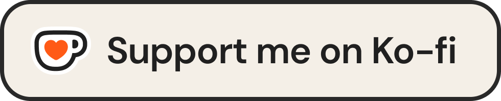</a>
